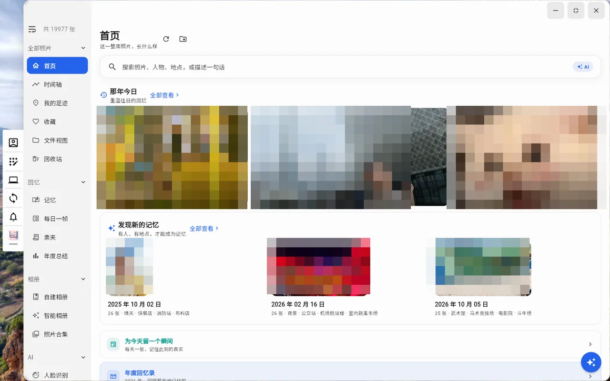

# WaterNasOS

> [简体中文](README.md) | **English**

WaterNasOS is a **self-hosted NAS system that runs on Windows**: phones, desktops, TVs and browsers all talk to the same server.
Photos, movies, music, books, files, notes, directory sync, downloads and a terminal — all on a machine you own,
with no public cloud in the loop.

- 🖼️ **AI photo library** — faces, scenes, activities, OCR, semantic search, footprint map, memories and life chapters; tens of thousands of photos stay usable
- 🎬 **Media library** — separate movie / TV / image / mixed libraries, per-codec transcoding tiers, automatic subtitles, playable on phone, TV and desktop
- 🔄 **Directory sync** — a standalone sync client sharing one engine with the desktop client, three-way comparison, two-way / upload-only / download-only
- 🧩 **22 built-in apps** — every feature is its own app with its own icon, page stack and server API namespace

---

## Screenshots

**Photo library home** — On this day, newly discovered memories, one frame a day, yearly recap. (Photos in the screenshot are pixelated.)



**Media library** — poster wall, continue watching, category rows; quality and subtitles are switched in the player.


---

## Three core features

### 1. AI photo library

**Browsing and organisation**

- **Timeline** grouped by day, waterfall (true aspect ratio) or grid view, with an "All / Photos / Videos" filter.
- **Albums**: user albums, smart albums (condition based), collections, plus a restorable trash.
- **Folder view** on top of the album semantics.
- **Per-user isolation**: every account only sees the photos it owns (timeline, faces, places, albums, favourites, trash and AI search share one visibility rule).
  The underlying thumbnail / face / place indexes stay global — isolation lives in the read layer.
- **Undoable bulk operations**: bulk delete is logged in `photo_operation_log` with preview → execute → undo.

**On-device AI (no cloud)**

| Capability | Implementation |
| --- | --- |
| Faces | **EdgeFace**; detect → 512-d embedding → clustering, with merge / split / rename / sample management |
| Scenes | **SigLIP2 base-224 + DETR-R50** multi-label with a "judgeability" gate |
| Activities | A separate activity dimension (swimming, running, laughing, group photo, wedding, party…), independently resettable |
| OCR | **PP-OCRv6 small** (falls back to v5 when v6 is absent, thresholds per version) |
| Semantics | CLIP dual tower + **Chinese phrase maximum matching** (512 local phrases, ordered binding) + a multilingual second recall path |
| Vector search | Vectors pushed down into SQLite (`sqlite-vec`); ~509ms → ~106ms on tens of thousands of photos |

**Memories and storytelling**

- **Memories**: candidates are computed per "same day + same place + many photos"; only a confirmation turns one into a memory.
  The card reads "place · what happened · photo count"; photos can be removed from a memory without deleting the originals.
- **Life chapters**: a book per year, one page per day — large photo + daily picks on the left, diary / place / tags on the right, arrow keys to flip.
- **One frame a day / yearly recap / ticket wallet / time comparison / trip replay**, plus a single discovery page with 7 tabs.

**Footprint map**

- Overlapping photos are clustered by **world-pixel distance** (`1.15 × marker diameter`); the cluster lands on the densest photo's **real coordinate**
  ⇒ clusters can never overlap visually. Recomputed only on zoom or data change, never on pan.
- Opening a cluster queries the **set** of geohash cells it covers (`WHERE IN`) ⇒ **the badge number equals the list length exactly**.
- Reverse geocoding picks the nearest name by real distance (30km gate) and shows **one language only**.

**Duplicate / similar cleanup**

- Content-level dedupe via `content_md5` (computed lazily) and feature clustering for similar shots.
  Metadata is merged only when exactly one copy survives (favourites / albums / scenes / activities / faces / location);
  OCR and visibility are not copied. Every cleanup is undoable.

### 2. Media library

- **Multiple libraries**: movie / TV / image / mixed, each with its own "show on home" switch. Image and mixed libraries get a dedicated grid + fullscreen viewer
  (natural-order sorting, waterfall, folder hierarchy, cover/thumbnail toggles, remembered per library).
- **Playing**: quality tiers (original / 4K / 1440p / 1080p / 720p / 480p) with **separate tier tables for H.264 and HEVC**,
  default quality remembered per (user, client).
- **HLS fMP4 transcoding** with an absolute `init.mp4` path; on failure the player automatically falls back to H.264 and resumes from the same position.
- **Audio**: optional loudness normalisation (two-pass `loudnorm`), downmix switch, and audio-only transcoding (`-c:v copy`) for videos without audio.
- **Subtitles**: default language (Simplified / Traditional Chinese, English, Japanese, Korean, off), automatic sidecar matching,
  text tracks rendered client-side and bitmap tracks burned in; **subtitles always float inside the picture**, never in the letterbox bars.
- **Fill / fit**: the picture fills the screen by default (edges cropped) and can be switched back to "fit" at any time.
  Android flips the native `PlayerView` resize mode; desktop and web use `BoxFit.cover`.

### 3. Directory sync

- **One engine, two clients**: the standalone `sync_client` (`WaterNasSync.exe`) and the desktop client share `packages/nascab_sync_core`.
- **Three-way comparison**: local state vs local baseline (`sync.db`) vs remote, so nothing is re-uploaded wholesale.
- **Same-file test**: equal size and mtime within 2000ms; **both directions write mtime back**, which stops the "re-download every round" loop.
- **Modes**: two-way / upload-only / download-only, with include / exclude rules and per-folder tasks.
- **Device identity**: Windows `MachineGuid`, macOS `IOPlatformUUID`, Linux `machine-id`.
- **Tasks and records**: `/api/sync` namespace plus task and record tables — every run leaves a trace.

---
## What's new in v2.0.0

### Smart discovery (new)

- **Memories**: candidate discovery → confirm / ignore / restore; cards read "place · what happened · photo count"; photos can be removed without deleting files.
- **One frame a day**, **ticket wallet** (train / flight / cinema tickets grouped by trip), **yearly recap**, **time comparison**, **trip replay**.
- **Duplicates and similar shots**: `content_md5` groups plus feature clustering, with preview → execute → undo.
- **Model catalogue**: faces / OCR / scenes / CLIP in one place, switchable.

### Timeline and activities

- The timeline now consumes the **activity** dimension (separate from scenes) with activity filters and semantic re-ranking.
- New "All / Photos / Videos" segmented filter.

### Memories and life chapters

- Memory page with three states (mine / pending / ignored) and a red dot for pending candidates.
- Life-chapter book: one year per book, one day per page, two-page spread, keyboard and mouse paging.
- Big search bar on the photo home; submitting it makes the first screen the results.

### Media

- **Fill / fit** fullscreen: fills the screen by default, no black frame; subtitles avoid the letterbox and stay on the picture.
- Android: a `setResizeMode` method channel on the native `PlayerView`, and player events now carry the real `videoWidth` / `videoHeight`.

### Platform and engineering

- **MCP open platform**: `/api/mcp` exposes 6 **read-only** tools secured by a dedicated `wnos_` token (not the login JWT); the plaintext token is shown only when rotated.
- **Model API settings** with a real outbound test request.
- **AI queue control**: pause / resume the recognition queue, reset OCR for the whole library, reset the activity dimension separately.
- **Self-hosted CJK fallback fonts** for the web build — no more "box with an X" on isolated networks.
- **Packaging slimming**: `onnx_models/**` is no longer packed into the asar (previously +886MB per build).
- **Group-photo combo albums removed**: the co-occurrence grouping was not accurate, so the entry point and page were dropped.

### Licence

- Back to **GPL-3.0 only** (the earlier GPL + AGPL split was withdrawn and `LICENSE-AGPL-3.0.txt` removed).

---

## Everything changed versus upstream (NasCabOS)

### Architecture and platform

- **Multi-device directory sync**: `sync_client` + `packages/nascab_sync_core`; new `/api/sync` namespace with `tableSyncTask` / `tableSyncRecord`.
- **Sub-account permissions**: app-level allow-list (`appAccessGuard`) plus path-level policies (`/api/user/access-policy`).
- **Multi-library media**: a `video_library` entity with movie / TV / image / mixed types, each with its own home visibility switch; legacy rows backfilled by `media_type`.
- **Dedicated photo / music clients** that reuse the main client through a path dependency (no duplicated business code).
- **Per-user photo isolation**: `photo_source` gains `uid`; visibility funnels through `PhotoTimeLineService.getValidPaths` with **no role exception**
  (super admins only see their own sources); write operations keep the super-admin override.
- **Dev instance isolation**: the single-instance lock moved to Electron `userData`.
- **Theme system**: 26 runtime colour schemes plus a design-token layer, applied through a single `ThemeApplyService`.

### Photos

- **Content-level dedupe on backup** (size + `content_md5`).
- **Faces**: EdgeFace; two root-cause fixes (worker never restarted after a clean exit; failed inference was marked as scanned so it never retried); merge logic fixed.
- **Scenes**: SigLIP2 + DETR with a judgeability gate and bounded retries.
- **Semantic search**: Chinese phrase matching with ordered binding and late fusion.
- **OCR**: PP-OCRv6 preferred (dictionary must be swapped together with the model).
- **Footprint map**: clustering, cluster scope and reverse geocoding all reworked.
- **Image / mixed library browsing**: sort menu (name / shot time / view time / added time, per library), natural ordering, waterfall, folder hierarchy, looping fullscreen viewer.
- **Phone backup**: single machine-wide configuration, permission prompts, corrected upload/skip counters.

### Media

- Per-codec quality tiers, absolute HLS fMP4 init path, automatic fallback to H.264, FFmpeg software fallback on Android,
  loudness normalisation, downmix, audio-only transcoding, default subtitle language, badge row (4K / HDR10+ / Dolby Vision / Atmos).

### Clients

- **Automatic sign-in** on desktop and Android after remembering server and account; logout can disable it.
- Refreshed app icons; desktop default wallpaper; 13 maintained locale bundles with key-parity scripts.
- Full OpenAPI single source of truth: `GET /api/openapi.json` + `tool/dump_openapi.js` (553 paths / 33 modules plus an auth-coverage audit).

### Global

- **Renamed** to **WaterNasOS** (server: WaterNasOSServer, TV: WaterNasOS TV, Flutter package `WaterNasOS`, desktop `WaterNasClient`, sync `WaterNasSync`).
- **Compatibility kept**: `applicationId`, iOS bundle id and HarmonyOS `bundleName` unchanged; protocol, device fingerprint and encrypted data formats untouched.
- **Slim repository**: third-party runtimes, AI models and the geonames database are no longer vendored; `tool/fetch_nascab_assets.py` fetches them.

---

## Repository layout

| Project | Description |
| --- | --- |
| `electron_server` | Backend (Electron + Express + SQLite) |
| `flutter_client` | Main client (Android / iOS / Windows / macOS) |
| `photo_client` / `music_client` | Photo / music clients (path dependency on the main client) |
| `sync_client` | Standalone Windows sync client |
| `packages/nascab_sync_core` | Shared sync engine |
| `harmony_client` | HarmonyOS client (work in progress) |
| `tv_android` / `tv_apple` | Android TV / Apple TV |
| `tool` | Build and static-check scripts |

---

## Built-in apps

Every feature is an **independent app**: its own icon, page stack and server API namespace, and on desktop it can be opened as its own window.
The default app list is served by the backend (`defaultApps` in `electron_server/src/config/config.js`) and can be hidden / reordered per user.

| App | key | Description |
| --- | --- | --- |
| Files | `folder` | Browse, upload/download, share |
| Photos | `photo` | AI photo library (see above) |
| Media | `movie` | Movie / TV / image / mixed libraries |
| Books | `book` | EPUB / MOBI / AZW3 / PDF / TXT |
| Music | `music` | Songs, albums, artists, playlists, collections; fullscreen player with animated lyrics |
| Notes | `note` | Rich-text notes |
| Encrypted space | `encrypted` | AES-encrypted storage, password stored encrypted locally |
| Media tools | `media_tool` | Batch image compression, video conversion |
| Sync | `sync` | Directory sync tasks and records |
| Terminal | `terminal` | Remote shell with destructive commands blocked |
| Transmission | `transmission` | BitTorrent |
| Docker | `docker` | Images, containers, tasks |
| Backup | `backup` | Phone photo / file backup |
| Mounts | `mounts` | Mount network shares into server folders |
| Sharing | `share` | WebDAV / FTP / SFTP shares |
| Monitor | `monitor` | Live hardware usage |
| Task centre | `task_center` | Background tasks |
| Security | `security` | Sign-in and security |
| Users | `user` | Users, app-level allow-lists, path-level permissions |
| Processes | `process` | Process list |
| Service | `nascab_service` | Server status and account |
| Settings | `setting` | Theme / language / cache location / playback / AI |

> `transmission`, `terminal`, `user`, `mounts`, `docker`, `nascab_service`, `monitor`, `process` are admin-only by default.

---

## Running

Server: download the third-party bundle (`libs` plugins, `onnx_models` OCR models) from
[Releases](https://github.com/colaKot/WaterNasOS/releases) and extract it into `electron_server`.

```bash
npm i
npm start
```

Client:

```bash
flutter pub get
flutter run -d windows   # or android / ios / macos
```

Web UI: drop the `flutter build web` output into `electron_server/web/main` and open the server port.

## Support

If WaterNasOS is useful to you, a donation is appreciated:

<div align="center">


</div>

Contact: cola23@126.com

## Licence

This repository is a derivative work of [NasCabOS](https://github.com/nascab/NasCabOS), distributed under **GNU GPL v3.0**; see [LICENSE](LICENSE).

- Original upstream copyright **Beijing Yunpiao Piao Technology Co., Ltd.** (© 2025) is retained verbatim.
- New and modified parts are copyright **colaKot** (© 2026), also under **GPL-3.0**.
- Redistributors must keep both notices and the full licence text, and must ship the corresponding complete source (GPL-3.0 §3 / §5).

## Third-party credits

- [Tabler Icons](https://github.com/tabler/tabler-icons) — UI icons (MIT, © Paweł Kuna), via `tabler_icons_plus`.
- **TrailSnap** ([github.com/LC044/TrailSnap](https://github.com/LC044/TrailSnap)) — an independently developed AI photo application (Vue3 + FastAPI + PostgreSQL/pgvector) positioned as "turning travels from merely shot into something worth keeping, showing and sharing." Our product planning for the photo domain referenced its productisation approach; **no TrailSnap code, model or data artifact is included in this project**.
- AI models (EdgeFace / SigLIP2 / DETR / PP-OCR / CLIP) remain under their own licences and run locally.
