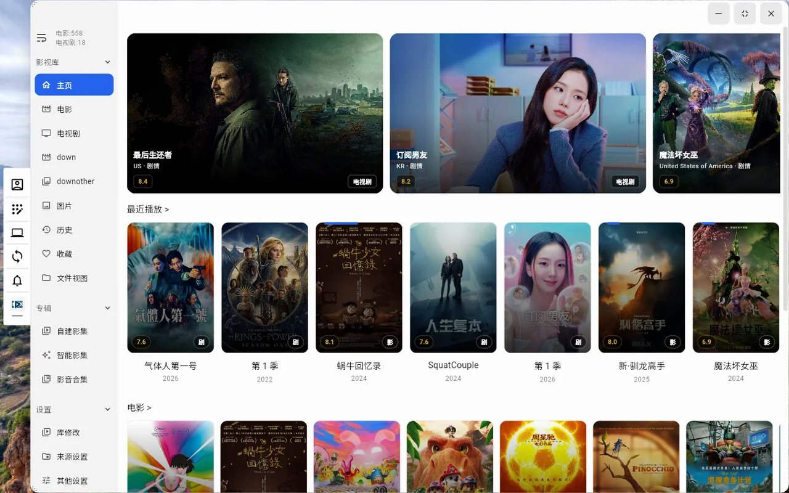

# WaterNasOS

> **简体中文** | [English](README.en.md)

WaterNasOS 是一套**跑在 Windows 上的自托管 NAS 系统**：手机、电脑、电视、网页共用同一个服务端，
照片、影视、音乐、图书、文件、笔记、同步、下载、终端全在一台你自己的机器上——
不依赖任何公有云，数据始终归你自己。

- 🖼️ **AI 相册**：人脸 / 场景 / 活动 / OCR / 语义搜索 / 足迹地图 / 记忆与人生章节，数万张照片照样翻得动
- 🎬 **影视库**：电影、剧集、图片、混合多库，按编码分档转码，字幕自动匹配，手机/电视/桌面都能播
- 🔄 **目录同步**：独立同步端 + 主客户端同一套引擎，三向比对，双向 / 仅上传 / 仅下载
- 🧩 **22 个内置应用**：每项功能都是独立 App，有独立图标、页面栈与服务端 API 命名空间

---

## 界面一览

**相册首页**：那年今日、发现新的记忆、每日一帧、年度记录，一屏把「今天值得看什么」摆出来。


**影视库**：海报墙 + 最近播放 + 分类浏览，点开即播，画质与字幕在播放器里切。



---

## 三大核心功能

### 一、AI 相册

不是「把照片按日期排一遍」，而是把照片**变成能问、能找、能回忆的东西**。

**浏览与组织**

- **时间线**：按天分组、瀑布流（按真实宽高比排版）与网格两种视图；「全部 / 图片 / 视频」三段筛选。
- **多级相册**：自建相册、智能相册（条件组合）、照片合集；回收站可还原 / 彻底删除。
- **文件视图**：按目录树看照片，和「相册语义」互不干扰。
- **按用户隔离**：每个账号只看到自己名下的照片（时间线、人脸、地点、相册、收藏、回收站、AI 搜索统一口径）；
  底层的缩略图、人脸、地点索引仍然全局共用——隔离只做在读取层，不重复算。
- **批量操作可撤销**：批量删除写入 `photo_operation_log`，支持「预演 → 执行 → 撤销」，撤销不是靠猜。

**AI 识别（全部本地推理，不出机器）**

| 能力 | 实现 |
| --- | --- |
| 人脸 | **EdgeFace** 模型；检测 → 512 维特征 → 聚类成「人物」，支持合并/拆分/命名/样本管理 |
| 场景 | **SigLIP2 base-224 + DETR-R50** 多标签，含「可判性」闸门（人像/静物不乱贴风景标签） |
| 活动 | 独立的活动维度（游泳 / 跑步 / 大笑 / 合影 / 婚礼 / 聚会…），与场景分开存储、可单独重置 |
| OCR | **PP-OCRv6 small**（无 v6 自动回退 v5，阈值按版本走），票面 / 截图 / 路牌 / 文档 |
| 语义 | CLIP 双塔 + **中文短语最大匹配**（本地 512 条中文短语 → 有序绑定）+ 多语言第二路召回 |
| 向量检索 | 向量下沉 SQLite（`sqlite-vec`），数万张照片的近邻检索从 509ms 降到 106ms |

**回忆与叙事**

- **记忆**：AI 按「同一天 + 同一片地方 + 一堆照片」聚出候选；你点「确认」才正式成为记忆，
  卡片上直接写「地点 · 干了什么 · 张数」；可以逐张移出，原图不删。
- **人生章节**：按年成书，一页 = 一天。左页大图 + 本日精选，右页影像日记 + 地点 + 标签；
  ←/→ 翻页，键盘和鼠标都能用。
- **一日一帧 / 年度记录 / 票夹 / 时光对照 / 旅程回放**：把「拍过」变成「值得再看一遍」。
- **发现页面**：7 个标签（记忆 / 一日一帧 / 票夹 / 年度 / 重复 / 相似 / 空缺）集中处理。

**足迹地图**

- 重叠照片按**世界像素距离**聚成簇（阈值 `1.15 × marker 直径`），落点取簇内最密那张的**真实坐标**
  ⇒ 聚合后数学上不可能互相压盖；只在缩放或数据变化时重算，**平移不重算**。
- 点开某簇 = 该簇覆盖的 geohash 格**集合**（服务端 `WHERE IN`）⇒ **角标数字与列表张数严格相等**。
- 地名反查按经纬度**真实距离**取最近（30km 闸门），且**只显示一种语言**（有中文就不拼英文）。

**重复 / 相似清理**

- 内容级去重（`content_md5` 惰性计算），相似图按特征聚类；清理**只在恰好留一张时合并元数据**
  （收藏 / 相册 / 场景 / 活动 / 人脸 / 位置），OCR 与可见性不复制；清理动作同样可撤销。

### 二、影视库

**库与浏览**

- **多库**：电影 / 电视剧 / 图片 / 混合媒体库各自独立，每库带「在主页显示」开关；
  图片库与混合库有专门的网格 + 全屏查看器（自然序排序、瀑布流、文件夹层级、封面/缩略图开关，按库记忆）。
- **海报墙**：最近播放、分类横滑、详情页展示 4K / HDR10+ / 杜比视界 / 杜比全景声等标识（直接读 ffprobe 元数据）。
- **详情页**：演职员、分集、清晰度、音轨与字幕轨选择。

**播放与转码**

- **画质分档**：原画 / 4K / 1440p / 1080p / 720p / 480p 多档，**H.264 与 HEVC 各有各的档位表**
  （同码率下 265 能承载更高分辨率），按「端 + 用户」隔离记忆默认档位。
- **HLS fMP4 转码**：初始化段写绝对路径（否则 ffmpeg 把 `init.mp4` 写到进程工作目录、客户端请求必 404）。
- **失败自动降级**：转码失败或编码不兼容 → 自动回退 H.264 并从原进度继续；Android 端 HLS 允许 FFmpeg 软解兜底。
- **音频**：可选**响度归一化**（两遍 `loudnorm`，按库开关）、**降混**开关、不支持音频的视频走**仅转音频**（`-c:v copy`）。
- **字幕**：默认字幕语言（简中 / 繁中 / 英文 / 日语 / 韩语 / 不加载），自动匹配同名外挂字幕；
  内嵌文本轨客户端渲染，图形字幕（PGS/VobSub）走转码烧录；**字幕始终浮在画面上**，不会掉进黑边。
- **画面铺满**：默认按屏幕铺满（裁掉溢出边缘），可一键切回「适应」（完整画面 + 黑边）；
  安卓端直接改原生 `PlayerView` 的 `RESIZE_MODE_ZOOM`，桌面与网页走 `BoxFit.cover`。

### 三、目录同步

- **两端一体**：独立同步端 `sync_client`（`WaterNasSync.exe`）与 PC 主客户端共用同一套引擎
  `packages/nascab_sync_core`，行为完全一致。
- **三向比对**：`本地状态` vs `本地 baseline（sync.db）` vs `远端`，先算差异再决定动作，不会「全量重传」。
- **判断同一文件**：大小相等且 mtime 差 ≤ 2000ms；**上下行都回写 mtime**，避免每轮重复下载。
- **模式**：双向 / 仅上传 / 仅下载；支持包含 / 排除规则、按文件夹粒度建任务。
- **设备识别**：Windows 用 `MachineGuid`、macOS 用 `IOPlatformUUID`、Linux 用 `machine-id`，同一台机器只算一个设备。
- **任务与记录**：服务端 `/api/sync` 命名空间 + 同步任务 / 同步记录两张表，每次运行都留痕可查。

---

## 内置应用

每项功能都是**独立 App**：有自己的图标、独立页面栈、独立的服务端 API 命名空间，
PC 端还能从主窗口单独打开。默认应用列表由服务端下发（`electron_server/src/config/config.js` 的 `defaultApps`），
用户可在设置里隐藏或重新排序。

| 应用 | key | 说明 |
| --- | --- | --- |
| 文件管理 | `folder` | 文件浏览、上传下载、分享 |
| 照片管理 | `photo` | AI 相册（见上） |
| 影视库 | `movie` | 电影 / 剧集 / 图片 / 混合多库 |
| 图书馆 | `book` | EPUB / MOBI / AZW3 / PDF / TXT |
| 音乐库 | `music` | 歌曲、专辑、歌手、播放列表、合集、收藏；全屏播放器（动态歌词、唱片动效、后台播放） |
| 笔记 | `note` | 富文本笔记 |
| 加密空间 | `encrypted` | AES 加密保存文件，密码加密后存本机数据库 |
| 媒体工具 | `media_tool` | 批量压缩图片、视频转换 |
| 同步管理 | `sync` | 目录同步任务与记录 |
| 终端 | `terminal` | 远程终端，屏蔽 rm、unlink 等敏感命令 |
| Transmission | `transmission` | BT 下载管理 |
| Docker | `docker` | 宿主机镜像、容器、任务管理 |
| 备份 | `backup` | 手机相册与文件备份 |
| 远程挂载 | `mounts` | 把网络磁盘挂载到服务器目录 |
| 分享管理 | `share` | WebDAV / FTP / SFTP 等协议分享磁盘 |
| 系统监控 | `monitor` | 实时硬件使用情况 |
| 任务中心 | `task_center` | 后台任务查看 |
| 安全中心 | `security` | 登录与安全设置 |
| 用户管理 | `user` | 用户与权限管理（应用级白名单 + 路径级权限） |
| 进程 | `process` | 进程查看 |
| 服务 | `nascab_service` | 服务端状态与账户 |
| 配置中心 | `setting` | 全局设置（主题 / 语言 / 缓存目录 / 播放 / AI） |

> `transmission`、`terminal`、`user`、`mounts`、`docker`、`nascab_service`、`monitor`、`process`
> 默认对普通用户隐藏，仅管理员可见。

---

## 本版本（v2.0.0）更新

### 智能发现（新增）

- **记忆**：候选发现 → 确认 / 忽略 / 恢复；记忆卡片写「地点 · 干了什么 · 张数」，可逐张移出（不删原图）。
- **一日一帧**：每天选一张代表作，配当日标签与地点。
- **票夹**：识别火车票 / 机票 / 电影票，按行程归组。
- **年度报告**：按年统计张数、覆盖地点、活跃人物、常用场景。
- **时光对照**：同一地点跨年份对照。
- **旅程回放**：按天/地点把一段行程串成时间线。
- **重复与相似**：重复按 `content_md5` 分组，相似按特征聚类；清理**预演 → 执行 → 可撤销**，只在恰好留一张时合并元数据。
- **模型目录**：识别模型（人脸 / OCR / 场景 / CLIP）集中查看与切换。

### 时间轴与活动维度

- 时间轴接入**活动标签**（与场景分开的维度），支持按活动筛选与语义重排。
- 控制栏新增「全部 / 图片 / 视频」三段切换。

### 回忆与人生章节

- **记忆页三态**：我的记忆 / 待确认 / 已忽略；待确认有红点提醒；卡片只做「确认」与「忽略」。
- **人生章节书本**：按年成书，一页一天，双页对开，键盘与鼠标翻页。
- **相册首页大搜索栏**：点开即搜索（推荐词 + 联想 + 最近搜索），提交后首屏直接是结果。

### 影视

- **全屏铺满 / 适应**：默认铺满，四周不再留黑边；字幕按真实宽高比避让黑边，始终压在画面上。
- 安卓原生 `PlayerView` 增加 `setResizeMode` 通道，播放器事件带上真实 `videoWidth / videoHeight`。

### 平台与工程

- **MCP 开放平台**：`/api/mcp` 暴露 6 个**只读**工具（搜索照片、读时间线、看人物/地点等），
  使用独立的 `wnos_` 令牌（非登录 JWT），令牌只在轮换时明文出现一次。
- **模型 API 配置**：可在相册 → AI 设置里配置外部模型接口并**真实出站测试**。
- **AI 队列控制**：一键暂停 / 恢复识别队列；OCR 全库重置；活动维度单独重置与开关。
- **中文字体自托管**：Web 端镜像 Noto 分片到本地（`fonts_fallback/`），内网不再因为拉不到 gstatic 而出现「方块里一个 X」。
- **打包瘦身**：`onnx_models/**` 不再进 asar（此前每次多打 886MB）。
- **移除了合影组合相册**：按「同框人脸组合」聚合的结果不准，入口与页面一并下线。

### 合规

- 许可证回到**纯 GPL-3.0**（撤销此前的 GPL + AGPL 分层授权表述，删除 `LICENSE-AGPL-3.0.txt`）。

---

## 相对上游（NasCabOS）的全部改动

以下为自 2026-10 起，本仓库相对上游的累积改动（按版本从早到晚）。

### 架构与平台

- **多端目录同步**：新增 `sync_client` 与共享核心包 `packages/nascab_sync_core`；服务端新增 `/api/sync` 命名空间与 `tableSyncTask`、`tableSyncRecord`。
- **子账号权限体系**：应用级访问白名单（`appAccessGuard`）+ 路径级细粒度权限（`/api/user/access-policy`），详见 `docs/子账号权限方案.md`。
- **影视库多库**：新增 `video_library` 实体，电影 / 电视剧 / 图片 / 混合四类库，各自独立开关；升级时按 `media_type` 回填老数据。
- **相册 / 音乐独立客户端**：`photo_client`、`music_client` 以 path 依赖复用主客户端，**不复制业务代码**（`main.dart` 只有三行，切启动模式即直达）。
- **相册用户隔离**：`photo_source` 增加 `uid`，可见性单点收敛到 `PhotoTimeLineService.getValidPaths`，**零角色例外**（超管也只看自己的源）；写操作保留超管越权。
- **开发实例隔离**：单实例锁改绑 Electron `userData`，开发实例可与日常实例并存。
- **主题系统**：26 套运行时配色 + 设计 token 层（`app_tokens.dart`），主题切换统一走 `ThemeApplyService`。

### 相册

- **内容级去重备份**：备份前比对大小 + `content_md5`，一致直接跳过。
- **人脸识别**：模型换 **EdgeFace**；修复两处根因——① 整批失败后 worker 取空队列退出、回调为空 ⇒ 永不再启动；② 推理失败也标记为已扫描 ⇒ 永不重扫。合并逻辑修掉「吞错 / 样本不迁移 / `face_count` 记账错误」。
- **场景识别**：SigLIP2 + DETR，含可判性闸门与重试封顶（永久错误立即弃、暂时错误 3 次弃）。
- **语义搜索**：中文短语最大匹配 + 有序绑定 + 迟到融合；CLIP 只认英文，中文先翻译再编码。
- **OCR**：自动优先 PP-OCRv6（换版本必须连字典一起换，否则静默返回空串）。
- **足迹地图**：聚合、点开范围、地名反查三处重做（见上文）。
- **图片 / 混合库浏览**：排序菜单（名称 / 拍摄时间 / 查看时间 / 添加时间，按库记忆）、自然序、瀑布流、文件夹层级、全屏查看器循环翻页。
- **相册备份**：整机单配置；权限引导；「上传 / 跳过」计数修正。

### 影视

- **画质按编码分档**、HLS fMP4 初始化段绝对路径、转码失败自动降级、FFmpeg 软解兜底、响度归一、降混、仅转音频、默认字幕语言、影片信息卡（4K / HDR10+ / DV / Atmos）。

### 客户端与体验

- 桌面与安卓端**记住服务端与账号后自动登录**；主动登出可取消。
- 各端 App 图标与首页图标整体更新；桌面主界面补齐默认背景。
- 13 个语言包同步维护（新增键必须全语言对齐，有脚本校验）。
- 完整 OpenAPI 单一真源：`GET /api/openapi.json` + `tool/dump_openapi.js`（553 路径 / 33 模块 + 鉴权覆盖审计）。

### 全局

- **项目更名**：显示名统一 **WaterNasOS**（服务端 WaterNasOSServer、TV 端 WaterNasOS TV）；Flutter 包名 `WaterNasOS`；
  桌面主客户端 **WaterNasClient**，独立同步端 **WaterNasSync**。
- **保持兼容**：`applicationId`、iOS Bundle ID、鸿蒙 `bundleName` 不变，已安装用户可覆盖升级；协议、设备指纹、加密数据格式均未改动。
- **仓库精简**：不再随仓库提供第三方运行时（sftpgo / openlist / ffmpeg / ffprobe / rclone / transmission）、AI 模型与地名库，用 `tool/fetch_nascab_assets.py` 从官方清单获取。

---

## 关于 TrailSnap（行影集）

[TrailSnap](https://github.com/LC044/TrailSnap) 是一款**独立开发的 AI 相册应用**（Vue3 + FastAPI + PostgreSQL/pgvector），
定位是「把旅行从拍过变成可留念、可展示、可分享」。我们在做相册域的功能规划时，**把它当作产品化参照系**读了一遍源码，
下面这些「产品化动作」是我们明确借鉴的。

**说明：本项目未包含 TrailSnap 的任何代码、模型或数据产物**——两边技术栈完全不同（Flutter + Node/Express + SQLite vs Vue + Python），
我们只借鉴**产品思路与交互结构**，实现全部重写。

### 借鉴了什么

| 借鉴点 | TrailSnap 的做法 | 我们在 WaterNasOS 里的落地 |
| --- | --- | --- |
| **写操作可撤销** | `agent_action_plans`：预演(proposed) → 确认 → 执行(executed) → 可撤销(undone)，带 `preview` / `undo_data`、7 天 TTL | `photo_operation_log` + `/operation/{undo,recent}`；重复清理支持 `dry_run` 预演，撤销可回到清理前 |
| **记忆系统的产品化** | 自动发现候选事件（线索召回 + 证据 + 置信度）→ 用户确认 → 正式记忆，六张子表 | 记忆页三态（我的 / 待确认 / 已忽略）+ 红点提醒；卡片只留「确认 / 忽略」；逐张移出不删原图 |
| **叙事层** | 人生章节书架 + 日记本翻书 + AI 日文案 | 人生章节书本：一页一天、双页对开、键盘翻页；文案只用真实标签拼接，**不编故事** |
| **一日一帧 / 年度报告** | 一日一帧影片作品；年度报告 10+ 章节 | 一日一帧 + 年度记录（张数 / 地点 / 人物 / 场景），发现页集中入口 |
| **票据 / 行程** | YOLO 检框 + OCR + 正则解析，3351 个车站白名单 | 票夹：识别火车票 / 机票 / 电影票并按行程归组 |
| **开放平台** | MCP Server（Streamable HTTP）+ 独立前缀的 Agent Token + scopes | `/api/mcp` 6 个只读工具 + `wnos_` 令牌 + scope 校验；**只读**是刻意的边界 |
| **AI 任务的可控性** | 三条优先队列、资源级信号量、按类暂停、空闲回收、指数退避重试 | AI worker 生命周期重做（干净退出也要按需重启）、重试封顶（永久错立即弃）、队列暂停/恢复、串行建会话避免 ONNX 崩溃 |
| **进度可视化** | `TaskManager` + 独立 worker 子进程 + DB 当队列 + SSE 进度 | 任务中心 + AI 队列状态（待处理 / 已完成 / 失败 / 跳过），`/app_ai/overview` 汇总 |
| **模型目录** | `model_catalog.json` 声明 13 个模型，可运行时切换 / 删除 / 自动下载 | 模型目录页：人脸 / OCR / 场景 / CLIP 集中查看与切换（本地模型随包或按需下载） |
| **备份去重口径** | `backup_key` 唯一索引 + `check_content` | 相册备份 `check_content`：size 粗筛 + `content_md5` 惰性计算 |

### 我们**没有**照抄的部分

- **底层 AI 能力**：人脸用 EdgeFace、场景用 SigLIP2 + DETR、OCR 用 PP-OCRv6，都是本地 ONNX 推理 + 我们自己的重试与并发治理；
  没有引入它的分类闭集、LLM 视觉描述、llama.cpp 本地模型。
- **Cesium 3D 地图**：我们坚持**聚合口径正确**（角标 == 列表张数）优先，用自研聚合 + 普通地图组件，不引入 3D 渲染栈。
- **以图搜图之外的「Agent 站内全家桶」**：不做站内 Agent、Skill 市场、需求交付平台——NAS 的边界是数据，不是聊天。

---

## 项目结构

| 项目 | 说明 |
| --- | --- |
| `electron_server` | 后端（Electron + Express + SQLite） |
| `flutter_client` | 主客户端（Android / iOS / Windows / macOS） |
| `photo_client` / `music_client` | 相册端 / 音乐端（path 依赖复用主客户端） |
| `sync_client` | Windows 独立同步客户端 |
| `packages/nascab_sync_core` | 目录同步核心包（主客户端与同步端共用） |
| `harmony_client` | 鸿蒙端（开发中） |
| `tv_android` / `tv_apple` | Android TV / Apple TV 端 |
| `tool` | 开发环境与构建脚本、静态自检脚本 |

## 运行方式

服务端：先从 [Releases](https://github.com/colaKot/WaterNasOS/releases) 下载第三方依赖包
（`libs` 第三方插件、`onnx_models` OCR/识别模型），解压后放到 `electron_server` 根目录。

```bash
npm i
npm start
```

客户端：

```bash
flutter pub get
flutter run -d windows   # 或 android / ios / macos
```

网页端：把 `flutter build web` 的产物放进 `electron_server/web/main` 目录，即可通过服务端端口直接访问。

## 捐助支持

如果 WaterNasOS 对您有帮助，欢迎捐助支持我们：

<div align="center">


</div>

商务合作 / 联系我们：cola23@126.com

## 许可证

本仓库是 [NasCabOS](https://github.com/nascab/NasCabOS) 的衍生作品，以 **GNU GPL v3.0** 分发，许可证全文见 [LICENSE](LICENSE)。

- 上游原始作品版权归 **Beijing Yunpiao Piao Technology Co., Ltd.** 所有（© 2025），此声明原样保留、不可移除。
- 本仓库新增与修改部分的版权归 **colaKot** 所有（© 2026），同样以 **GPL-3.0** 授权。
- 任何再分发者均须保留上述版权声明与许可证全文；若把本软件（含修改版）对外分发或提供下载，须一并提供对应的完整源代码（GPL-3.0 §3 / §5）。

## 第三方资源与致谢

- [Tabler Icons](https://github.com/tabler/tabler-icons)：界面图标（MIT，© Paweł Kuna），通过 `tabler_icons_plus` 引入。
- [TrailSnap（行影集）](https://github.com/LC044/TrailSnap)：独立开发的 AI 相册应用。本项目的**相册域产品化思路**参考了它，具体借鉴点见上文「关于 TrailSnap」。
  > 本项目**未包含** TrailSnap 的任何代码、模型或数据产物。
- 各 AI 模型（EdgeFace / SigLIP2 / DETR / PP-OCR / CLIP）版权归各自作者所有，本项目仅按各自许可证在本地推理使用。
